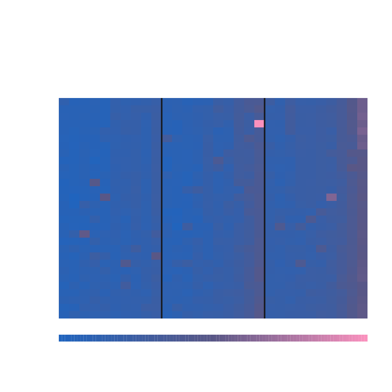
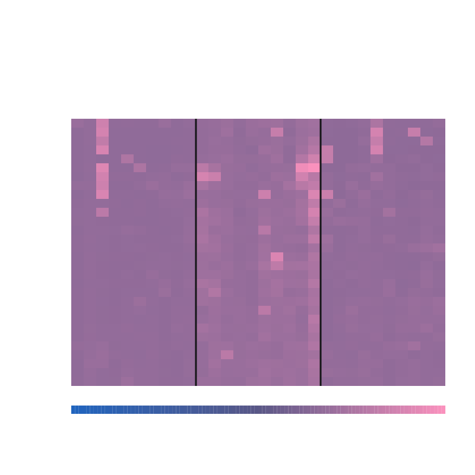
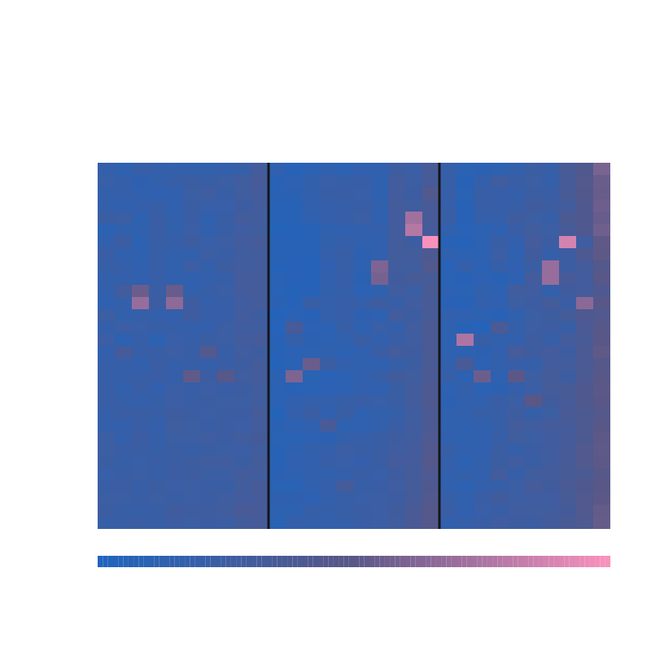
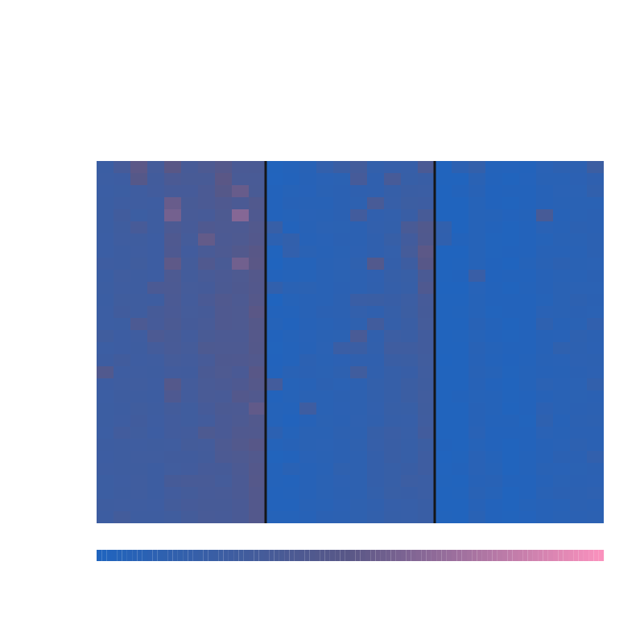

<div align="center">
  
  <p><strong>Typed module lookup for Roblox Luau</strong></p>
</div>

<div align="center">
  <!-- Sponsor -->
  <a href="https://github.com/sponsors/Kooraseru"></a>
  <!-- Stars -->
  <a href="https://github.com/kooraseru-hub/registry"></a>
  <!-- Forks -->
  <a href="https://github.com/Kooraseru-Hub/registry/forks"></a>
  <!-- USA! USA! USA! -->
  
</div>

---

Registry lets scripts share a named set of values and ModuleScripts. Register entries once, then look them up from any script that imports the registration. Luau infers the valid paths from the registration keys. ModuleScripts load on demand, and successful exports are cached.

## Installation

Choose one installation method:

1. **Studio model (recommended):** download `Registry.rbxm` from the [2.0.0 release](https://github.com/Kooraseru-Hub/Registry/releases/tag/2.0.0). Import the model into Studio and place the resulting `Registry` ModuleScript under `ReplicatedFirst`.
2. **Source:** copy [`source/Registry.luau`](https://github.com/Kooraseru-Hub/Registry/blob/main/source/Registry.luau) (also included in `Registry.zip`) into a ModuleScript named `Registry` under `ReplicatedFirst`.

Use `ReplicatedFirst` for early client bootstrappers, or `ReplicatedStorage` for ordinary shared code; adjust the require path accordingly. Early replication of Registry does not make its registered dependencies replicate earlier. Wait for any dependencies outside ReplicatedFirst when necessary.

Enable the new Luau type solver under **Workspace > Scripting > UseNewLuauTypeSolver**.

## Quick start

In `ReplicatedStorage`, create a ModuleScript named `Settings` that returns your settings. Create a sibling ModuleScript named `Registrations` with the following source.

```luau
--!strict
const Registry = require("@game/ReplicatedFirst/Registry")

return Registry.Register({
    ["Game/Settings"] = script.Parent.Settings,
})
```

From a separate script, import the shared registration and look up the entry.

```luau
--!strict
const registry = require("@game/ReplicatedStorage/Registrations")
const settings, ok = registry:Get("Game/Settings")

if ok then
    print(settings)
else
    warn(settings)
end
```

`Get` returns `value, true` on success or `message, false` when a path is missing or a ModuleScript fails to load. The result is typed as `unknown`. Narrow it before accessing its fields.

## Why use Registry?

Use Registry when several scripts need a shared set of named modules. Consumers get autocomplete for registered names, and moving or swapping a ModuleScript takes one edit in the registration table. Modules load on first use, and callers can handle a failed load through the success flag.

For a dependency you already know and can load once, keep a direct `require` in a local binding. It gives Luau the module's export type and avoids doing a lookup on each use.

## Benchmarks

The benchmarks compare direct `require` and `Registry:Get` for first loads and repeated lookups. Each cell shows median latency per operation.

<div align="center">

<p align="center">
  
  
</p>

<p align="center">
  
  
</p>

Measured <time datetime="2026-11-24T03:25:03Z">2026-11-24 03:25:03 UTC</time><br>
Roblox Open Cloud<br>
Test place version <code>603</code><br>
Source commit <code>9526ea1ea7b290800d6784af3fcb68f01fb6354b</code>

</div>

<details>
<summary>Workloads and measurement details</summary>

Each phase is a 30 × 30 matrix. In the first-load phase, row `r` uses `floor(16 × 1.16^(r − 1))` calls, each to a distinct ModuleScript. Columns combine arithmetic, table writes, or mixed initialization with ten work levels from 0 to 512 steps. Each method receives its own fresh clones for every trial. In the repeated-lookup phase, rows use `floor(256 × 1.33^(r − 1))` calls and columns combine ten registry sizes from 1 to 2,048 modules with sequential access, a shuffle seeded with 42, or a hot subset containing the first eighth of the modules, with a minimum of one. Both methods run an untimed warmup before sampling.

Each cell records four paired trials. Both methods walk the same index sequence, and the order alternates so each method goes first twice. The harness uses `os.clock()` around the full lookup loop, including index traversal and checksum accumulation. Clone setup, registration, warmup, and checksum comparison happen outside the timer. The harness rejects unequal or zero checksums. For each method it divides elapsed seconds by the operation count and takes the median of the four values. Both heatmaps in a phase share a logarithmic color scale.

To reproduce, check out the revision of interest and run **Registry: Benchmark and Build** with Ctrl+Shift+B on Windows. It generates a fresh test place from the checkout and starts a new Studio process. For a revision comparison, use the same machine, Studio version, power settings, and workload. Close competing workloads and repeat both revisions to see how much timings vary between runs. Keep the raw `matrix-samples.csv` alongside the charts so you can recompute each median and inspect the paired trials. Four pairs per cell describe the run. Repeat the experiment before treating small differences as meaningful.


</details>

## More information

<div align="center">
  <!-- Documentation -->
  <a href="https://kooraseru-hub.github.io/Registry/"></a>
  <!-- Benchmark -->
  <a href="https://github.com/Kooraseru-Hub/Registry/tree/source/tests/registry/benchmarks"></a>
  <!-- Contribute -->
  <a href="CONTRIBUTING.md"></a>
  <!-- License -->
  <a href="LICENSE"></a>
</div>
