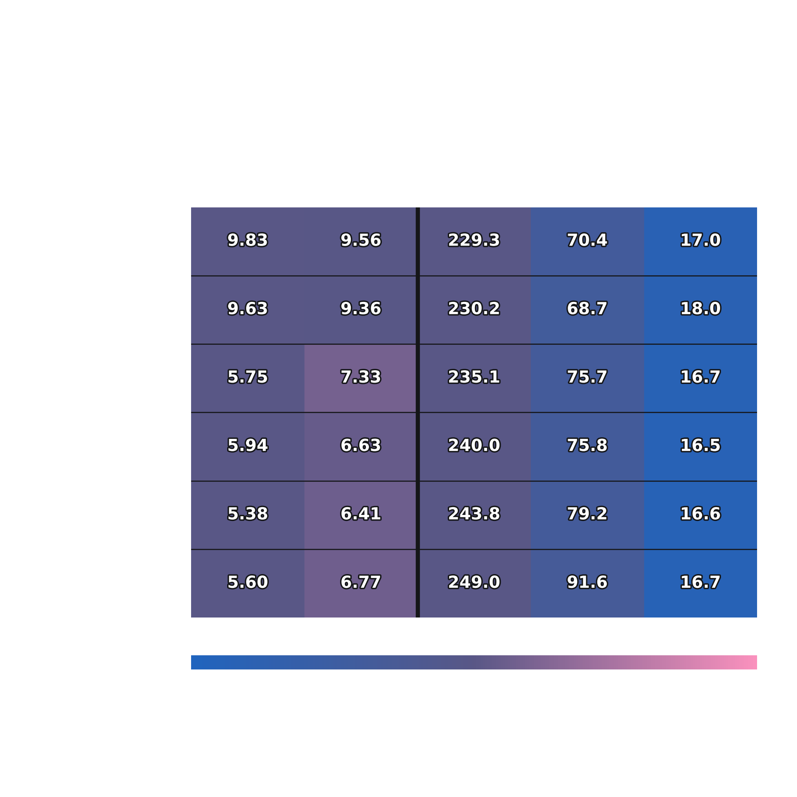

# Registry benchmark

## 30×30 comparisons

| Implementation | First load | Cached lookup |
| --- | --- | --- |
| Direct require | [PNG](../../results/benchmarks/require-cold-matrix.png) | [PNG](../../results/benchmarks/require-warm-matrix.png) |
| Registry | [PNG](../../results/benchmarks/registry-cold-matrix.png) | [PNG](../../results/benchmarks/registry-warm-matrix.png) |

[Raw paired trials](../../results/benchmarks/matrix-samples.csv)

Rows increase the operations per trial. Cold columns vary initialization work per ModuleScript across arithmetic, table writes, and mixed work. Warm columns vary the registered module count and access pattern across sequential, seeded shuffled, and a hot subset of one eighth of the registered modules. Each cell shows median latency per operation across four trials. Blue is faster and pink is slower. The two implementations share the same logarithmic color scale within each phase.

Cold trials use fresh clones for each method. Warm trials load both caches before timing. Runtime setup and checksum comparison are outside the timer. The measured Registry calls include its lookup and error-handling costs. Registry construction and fixture cloning are outside both figures. Measurements were taken in Roblox Studio 0.748.0.7481526 on Windows with a Snapdragon X Elite X1E78100. Four trials per cell describe this run and do not establish statistical significance.

Run the two phases in a fresh Studio session using the local test place.

```luau
local matrix = require(game.ReplicatedStorage.benchmarks.registry.Matrix)
matrix.Run(true) -- cold
matrix.Run(false) -- warm
```

Run `node benchmarks/registry/plot-matrix.cjs` from the repository root to render the archived samples into four SVGs. Pass the Studio output log and an optional output directory to generate the charts and CSV from a fresh run. The CSV retains the original elapsed seconds.

## Compact comparison



**Same workload, three access methods.** Each module returns the number 1. The checksum verifies that every measured call returned the expected value. Timings are medians of six trials on Roblox Studio 0.748.0.7481526, Windows, Snapdragon X Elite X1E78100.

- **Cold:** Each method loads fresh ModuleScript clones once. Cloning and registry construction are outside the timer.
- **Warm:** Each method reads the same sequence 65,536 times after warmup. The pre-resolved baseline indexes an array of exports. Method order rotates. Shuffled cases use a fixed permutation.
- **Result:** Warm Registry lookup was 2.72–3.35× as fast as repeated direct require. At 256 and 1,024 modules, cold Registry lookup took 12–27% longer. Pre-resolved access was fastest in every warm case.

## Reproduce

Generate a fresh place with `node tests/registry/Studio/build.cjs`, open `build/artifacts/tests/studio/Registry.rbxlx`, and run the two benchmarks in a fresh Studio session. Each prints a line per measured trial.

```luau
local benchmark = game.ReplicatedStorage.benchmarks.registry
require(benchmark.Cold).Run()
require(benchmark.Warm).Run()
```

[Raw timings](../../results/benchmarks/samples.csv) · [Plot script](plot.cjs). Run `node benchmarks/registry/plot.cjs` from the repository root to render an SVG under `build/artifacts/benchmarks/compact`.

## Require call forms

[Raw call-form samples](../../results/benchmarks/require-forms.csv) cover a literal string path, a string passed through a function binding, a DataModel property access inside the call, a previously bound ModuleScript, a bound require function with a ModuleScript argument, and Registry lookup.

Run `bash tests/registry/Studio/run.sh RequireForms` with Windows Studio installed. The runner rotates six forms across six trials. Each cold trial combines 64 separately timed first calls to fresh clones. Each warm trial times 100,000 calls after warmup. All forms invoke the same wrapper structure and read equivalent numeric exports. Fixture cloning, Registry construction, and checksum checks are outside the timed sections.
