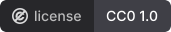

  
  
<strong>Typed module lookup for Roblox Luau</strong>

  <!-- Sponsor -->
  
  <!-- Stars -->
  
  <!-- Forks -->
  
  <!-- USA! USA! USA! -->
  

---

{{registry.body}}

## More information

  <!-- Documentation -->
  
  <!-- Benchmark -->
  
  <!-- Contribute -->
  
  <!-- License -->
  

